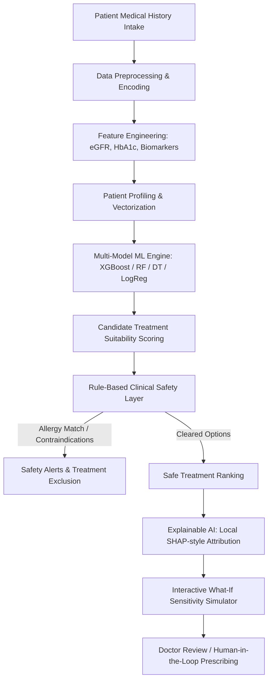

# MediPersonal AI — Platform for Personalized Treatment Based on Patient History

**Department of Computer Science & Engineering**  
**ABESEC Ghaziabad (Session 2023-24)**  
**Project Type:** Application / Research-Based AI & Machine Learning Project  

### Project Team & Supervision
- **Group Member (1):** Sneha (Roll No: 2400320101105, CSE28)
- **Group Member (2):** Tanisha (Roll No: 2400320101158, CSE28)
- **Group Member (3):** Suhani Saraswat (Roll No: 2400320101129, CSE28)
- **Project Guide:** Dr. Anshul Tickoo

---

## 1. Problem Introduction & Research Motivation
Healthcare treatment has traditionally been prescribed based primarily on a patient's current disease diagnosis, immediate acute symptoms, and generalized clinical guidelines. However, two patients diagnosed with the identical medical condition may respond radically differently to the same pharmaceutical therapy due to distinct variations in:
- Multidimensional medical history & disease chronicity
- Previous treatment responses (efficacy vs. resistance)
- Renal function & laboratory biomarkers (eGFR, HbA1c, Serum Creatinine, Blood Pressure)
- Documented drug allergies & hypersensitivities
- Co-existing comorbidities (e.g., Chronic Kidney Disease, Heart Failure, Asthma)
- Prior severe adverse drug reactions

### The Research Gap
While the vast majority of healthcare ML projects concentrate exclusively on **disease prediction/classification**, this project addresses the critical clinical gap: **personalized treatment recommendation and safety ranking based on longitudinal patient medical history**.

---

## 2. System Architecture & Project Flow (Synopsis Section 1.5)



---

## 3. Core Modules & Key Advancements

### 3.1. Multi-Model Machine Learning Engine (Steps 3 & 5)
Four distinct machine learning algorithms are trained, evaluated, and switchable on the fly:
1. **XGBoost (Extreme Gradient Boosting):** Advanced gradient-boosted decision trees that capture complex non-linear clinical feature interactions (**Top-1 Accuracy: 98.25%, ROC-AUC: 0.9950**).
2. **Decision Tree Classifier:** Highly interpretable hierarchical decision paths (**Accuracy: 97.00%, ROC-AUC: 0.9892**).
3. **Random Forest Classifier:** Robust bagging ensemble averaging over multiple decision trees (**Accuracy: 92.75%, ROC-AUC: 0.9939**).
4. **Logistic Regression:** Linear baseline with calibrated multinomial probability estimates (**Accuracy: 77.00%, ROC-AUC: 0.9270**).

### 3.2. Rule-Based Clinical Safety Layer (Step 8)
A rigorous 4-tier clinical safety filter executes in real time:
- **Allergy Check:** E.g., Sulfa allergy excludes Sulfonylureas (Glimepiride); ACE-inhibitor allergy excludes Lisinopril/Enalapril.
- **Renal Contraindication Check:** Strictly excludes Metformin if eGFR < 30 mL/min/1.73m² (lactic acidosis risk) and caps dosages for eGFR 30–44.
- **Comorbidity Contraindication:** Strictly excludes Beta-Blockers in patients with active Asthma / Bronchospasm.
- **Drug-Drug Interaction Risk:** Identifies combinations that precipitate severe hyperkalemia or acute renal hypoperfusion.

### 3.3. Explainable AI (XAI) (Step 9)
Provides doctors with transparent explanations answering *"Why was this treatment ranked higher?"*:
- **Local SHAP Waterfall:** Decomposes positive boosts (+24% for favorable response history, +18% for preserved renal eGFR) and negative penalties (-35% for prior adverse reaction).
- **Global Feature Importance:** Ranks top clinical dimensions influencing recommendation outputs.
- **Clinical Rationale Synthesis:** Auto-generates plain-English medical justifications.

### 3.4. Interactive "What-If" Sensitivity Simulator (Step 7)
Allows authorized clinicians to test scenario variations:
- Live sliders for **eGFR (15–120 mL/min)**, **HbA1c (5.0–13.0%)**, **Systolic BP (90–200 mmHg)**, and **Age**.
- Toggles for comorbidities (CKD, Heart Failure, Asthma) and drug allergies.
- **Real-Time Dynamic Re-Ranking Diff:** Watch treatments immediately jump or drop ranks (e.g., Metformin dropping from #1 to **⛔ EXCLUDED** when eGFR drops below 30 mL/min).

### 3.5. Cloud Document Hub & OCR Clinical Entity Parser
- **Cloud Storage Integration:** Cloudinary / secure cloud storage pipeline for medical lab reports, discharge summaries, and prescription scans.
- **Automated Medical OCR & Entity Extraction:** Parses uploaded PDFs and medical images for biomarkers: eGFR, HbA1c, Serum Creatinine, Blood Pressure, and Allergies.
- **One-Click Clinical Record Sync:** Directly imports extracted laboratory findings into the active patient profile and instantly triggers treatment re-ranking.

### 3.6. Printable Clinical Decision Support (CDS) Summary
- Generates formatted medical CDS reports complete with patient history, ranked options, safety alerts, explainability factors, and doctor sign-off blocks adhering to **Human-in-the-Loop** ethical AI standards.

---

## 4. Model Evaluation Benchmarking (Step 11)

Evaluated on 400 test cohort records:

| Machine Learning Model | Model Architecture | Classification Accuracy | Weighted Precision | Weighted Recall | Weighted F1-Score | ROC-AUC | Top-1 Accuracy | Top-3 Accuracy |
|---|---|---|---|---|---|---|---|---|
| **XGBoost Classifier** | Gradient Boosted Trees | **98.25%** | **98.25%** | **98.25%** | **98.24%** | **0.9950** | **98.25%** | **99.50%** |
| **Decision Tree** | Hierarchical Tree | 97.00% | 97.14% | 97.00% | 96.94% | 0.9892 | 96.75% | 98.50% |
| **Random Forest** | Ensemble Bagging | 92.75% | 93.13% | 92.75% | 92.17% | 0.9939 | 92.75% | 99.50% |
| **Logistic Regression** | Linear Baseline | 77.00% | 75.95% | 77.00% | 76.20% | 0.9270 | 77.00% | 99.00% |

---

## 5. Technology Stack

- **Backend API & ML Engine:** Python 3.14 / FastAPI, Uvicorn, Pydantic, Scikit-learn 1.9+, XGBoost 3.4+, NumPy, Joblib.
- **Frontend User Interface:** Semantic HTML5, Vanilla CSS3 Design System (Glassmorphic dark medical theme, responsive grid, micro-animations), Vanilla JavaScript (Zero bloated frameworks, runs in any modern browser).
- **Cloud & File Storage:** Cloudinary REST API / Medical Cloud Vault, SHA-256 file integrity hashing, client-side FileReader OCR entity extraction.

---

## 6. How to Run the Project

### Option A: One-Click Launch (Recommended)
Double-click `start_system.bat` or run in PowerShell:
```powershell
.\start_system.ps1
```
This automatically verifies dependencies, starts the FastAPI server on `http://localhost:8000`, and opens `index.html` in your default browser.

### Option B: Manual Launch
1. **Activate Python Virtual Environment & Install Dependencies:**
   ```powershell
   .\venv\Scripts\Activate.ps1
   pip install -r requirements.txt
   ```

2. **Train Models (Optional - Already Pre-Trained & Serialized in `ml_service/models/`):**
   ```powershell
   python ml_service/train_models.py
   ```

3. **Start the FastAPI ML Backend:**
   ```powershell
   uvicorn ml_service.main:app --host 127.0.0.1 --port 8000 --reload
   ```

4. **Open Frontend:**
   Double-click `index.html` in your browser. The dashboard automatically detects the live FastAPI service!

---

## 7. Ethical AI & Human-in-the-Loop Statement
In compliance with the WHO Guidelines on *Ethics and Governance of Artificial Intelligence for Health* and the TRIPOD+AI standards cited in the synopsis report, **MediPersonal AI is strictly designed as an assistive Clinical Decision Support System (CDSS) to assist qualified medical professionals. It does not independently prescribe medications.** Final treatment decisions remain exclusively with the licensed healthcare provider.
