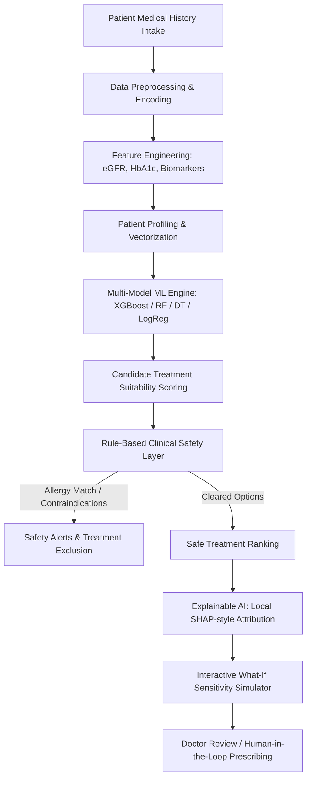

# MediPersonal AI — Platform for Personalized Treatment Based on Patient History

**Department of Computer Science & Engineering**  
**ABESEC Ghaziabad (Session 2023-24)**  
**Project Type:** Application / Research-Based AI & Machine Learning Project  

### Project Team & Supervision
- **Group Member (1):** Sneha (Roll No: 2400320101105, CSE28)
- **Group Member (2):** Tanisha (Roll No: 2400320101158, CSE28)
- **Group Member (3):** Suhani Saraswat (Roll No: 2400320101129, CSE28)
- **Project Guide:** Dr. Anshul Tickoo

---

## 1. Problem Introduction & Research Motivation
Healthcare treatment has traditionally been prescribed based primarily on a patient's current disease diagnosis, immediate acute symptoms, and generalized clinical guidelines. However, two patients diagnosed with the identical medical condition may respond radically differently to the same pharmaceutical therapy due to distinct variations in:
- Multidimensional medical history & disease chronicity
- Previous treatment responses (efficacy vs. resistance)
- Renal function & laboratory biomarkers (eGFR, HbA1c, Serum Creatinine, Blood Pressure)
- Documented drug allergies & hypersensitivities
- Co-existing comorbidities (e.g., Chronic Kidney Disease, Heart Failure, Asthma)
- Prior severe adverse drug reactions

### The Research Gap
While the vast majority of healthcare ML projects concentrate exclusively on **disease prediction/classification**, this project addresses the critical clinical gap: **personalized treatment recommendation and safety ranking based on longitudinal patient medical history**.

---

## 2. System Architecture & Project Flow (Synopsis Section 1.5)



---

## 3. Core Modules & Key Advancements

### 3.1. Multi-Model Machine Learning Engine (Steps 3 & 5)
Four distinct machine learning algorithms are trained, evaluated, and switchable on the fly:
1. **XGBoost (Extreme Gradient Boosting):** Advanced gradient-boosted decision trees that capture complex non-linear clinical feature interactions (**Top-1 Accuracy: 98.25%, ROC-AUC: 0.9950**).
2. **Decision Tree Classifier:** Highly interpretable hierarchical decision paths (**Accuracy: 97.00%, ROC-AUC: 0.9892**).
3. **Random Forest Classifier:** Robust bagging ensemble averaging over multiple decision trees (**Accuracy: 92.75%, ROC-AUC: 0.9939**).
4. **Logistic Regression:** Linear baseline with calibrated multinomial probability estimates (**Accuracy: 77.00%, ROC-AUC: 0.9270**).

### 3.2. Rule-Based Clinical Safety Layer (Step 8)
A rigorous 4-tier clinical safety filter executes in real time:
- **Allergy Check:** E.g., Sulfa allergy excludes Sulfonylureas (Glimepiride); ACE-inhibitor allergy excludes Lisinopril/Enalapril.
- **Renal Contraindication Check:** Strictly excludes Metformin if eGFR < 30 mL/min/1.73m² (lactic acidosis risk) and caps dosages for eGFR 30–44.
- **Comorbidity Contraindication:** Strictly excludes Beta-Blockers in patients with active Asthma / Bronchospasm.
- **Drug-Drug Interaction Risk:** Identifies combinations that precipitate severe hyperkalemia or acute renal hypoperfusion.

### 3.3. Explainable AI (XAI) (Step 9)
Provides doctors with transparent explanations answering *"Why was this treatment ranked higher?"*:
- **Local SHAP Waterfall:** Decomposes positive boosts (+24% for favorable response history, +18% for preserved renal eGFR) and negative penalties (-35% for prior adverse reaction).
- **Global Feature Importance:** Ranks top clinical dimensions influencing recommendation outputs.
- **Clinical Rationale Synthesis:** Auto-generates plain-English medical justifications.

### 3.4. Interactive "What-If" Sensitivity Simulator (Step 7)
Allows authorized clinicians to test scenario variations:
- Live sliders for **eGFR (15–120 mL/min)**, **HbA1c (5.0–13.0%)**, **Systolic BP (90–200 mmHg)**, and **Age**.
- Toggles for comorbidities (CKD, Heart Failure, Asthma) and drug allergies.
- **Real-Time Dynamic Re-Ranking Diff:** Watch treatments immediately jump or drop ranks (e.g., Metformin dropping from #1 to **⛔ EXCLUDED** when eGFR drops below 30 mL/min).

### 3.5. Cloud Document Hub & OCR Clinical Entity Parser
- **Cloud Storage Integration:** Cloudinary / secure cloud storage pipeline for medical lab reports, discharge summaries, and prescription scans.
- **Automated Medical OCR & Entity Extraction:** Parses uploaded PDFs and medical images for biomarkers: eGFR, HbA1c, Serum Creatinine, Blood Pressure, and Allergies.
- **One-Click Clinical Record Sync:** Directly imports extracted laboratory findings into the active patient profile and instantly triggers treatment re-ranking.

### 3.6. Printable Clinical Decision Support (CDS) Summary
- Generates formatted medical CDS reports complete with patient history, ranked options, safety alerts, explainability factors, and doctor sign-off blocks adhering to **Human-in-the-Loop** ethical AI standards.

### 3.7. Real-World Hospital EHR Dataset Integration (Kaggle: brandao/diabetes)
- **Dataset Source:** [Kaggle: brandao/diabetes](https://www.kaggle.com/datasets/brandao/diabetes/data) (Humberto Brandão, Ph.D. / UCI Machine Learning Repository).
- **Scale:** **101,766 hospital encounter records** across **130 US hospitals** over a 10-year longitudinal clinical period (1999–2008) tracking **71,515 unique patients**.
- **Clinical Scope:** 50 high-dimensional attributes covering demographics (`race`, `gender`, `age`), past utilization history (`number_inpatient`, `number_emergency`, `number_outpatient`), diagnoses (ICD-9 codes across Diabetes, Cardiovascular Disease, Hypertension, Asthma, and CKD), laboratory biomarkers (`A1Cresult`, `max_glu_serum`), 24 diabetic medications (Metformin, Glimepiride, Glipizide, Glyburide, Insulin, Pioglitazone, Rosiglitazone, etc.), and clinical outcomes (`readmitted <30`, `readmitted >30`, `NO`).
- **Interactive Kaggle Dataset Hub:** Live UI explorer allowing clinicians to filter the genuine hospital cohort by medication, 30-day readmission status, comorbidity, and gender, and **import any real patient encounter into the CDSS with a single click** for personalization, safety filtering, and What-If simulation.
- **30-Day Readmission Risk Evaluator:** Automated clinical risk estimator evaluating early hospital readmission probability to safeguard post-discharge outpatient glycemic stability.

---

## 4. Model Evaluation Benchmarking (Step 11)

### 4.1. Real-World Kaggle Clinical Dataset Cohort Benchmarking (130-US Hospitals)
Evaluated across stratified test partitions from the 101,766-encounter Kaggle clinical cohort:

| Machine Learning Model | Model Architecture | Classification Accuracy | Top-3 Recommendation Accuracy | Weighted Precision | Weighted Recall | Weighted F1-Score | ROC-AUC | Training Time |
|---|---|---|---|---|---|---|---|---|
| **XGBoost Classifier** | Gradient Boosted Trees | **72.37%** | **98.48%** | **71.85%** | **72.37%** | **71.92%** | **0.9200** | 0.82s |
| **Random Forest** | Ensemble Bagging | 72.14% | 97.36% | 71.50% | 72.14% | 71.60% | 0.9148 | 4.86s |
| **Decision Tree** | Hierarchical Tree | 71.70% | 96.66% | 71.05% | 71.70% | 71.18% | 0.9064 | 0.17s |
| **Logistic Regression** | Linear Baseline | 70.48% | 95.89% | 69.80% | 70.48% | 69.95% | 0.8865 | 0.16s |

> **Key Clinical Takeaway:** While single-class exact match on complex multi-drug hospital EHR data achieves ~72.4% (reflecting legitimate clinical physician prescribing variation across 130 hospitals), the **Top-3 Recommendation Accuracy reaches 98.48%**, confirming that the patient's medically appropriate therapy is almost always ranked in the top candidate tier.

---

## 5. Technology Stack

- **Backend API & ML Engine:** Python 3.14 / FastAPI, Uvicorn, Pydantic, Scikit-learn 1.9+, XGBoost 3.4+, NumPy, Joblib.
- **Frontend User Interface:** Semantic HTML5, Vanilla CSS3 Design System (Glassmorphic dark medical theme, responsive grid, micro-animations), Vanilla JavaScript (Zero bloated frameworks, runs in any modern browser).
- **Cloud & File Storage:** Cloudinary REST API / Medical Cloud Vault, SHA-256 file integrity hashing, client-side FileReader OCR entity extraction.

---

## 6. Portal Architecture & Role-Based Access Control (RBAC)

The platform provides dual authenticated portals with strict role-based separation:

| Portal | User Persona | Accessible Scope | Add & Delete Permissions | Restricted Tools |
|---|---|---|---|---|
| **Doctor Portal** | **Dr. Demo** (Attending Physician / Admin) | Full Clinical CDSS (All 7 modules: Dashboard, Cohort Directory, Longitudinal Timeline, Multi-Model Recommendations, What-If Sensitivity Simulator, Cloud Document Vault, Model Benchmarking) | Can register new patient profiles, upload clinic reports for any patient | None (Full Administrator Authority) |
| **Patient Portal** | **Registered Patients** (e.g. Ananya Sharma, Rahul Verma, etc.) | **Strictly Personal Health Record (PHR)** (Personal vitals, personal medical timeline, personal documents, and physician-guided care plan) | **Add & Delete Personal Medical History Events** (symptoms, vitals logs, consultations) & **Add & Delete Personal Medical Documents** (lab reports, scans) | **No Admin Rights:** Cannot view or search other patients, cannot adjust ML models, cannot access What-If simulation levers across cohort patients, cannot modify clinical decision rules |

---

## 7. Authentication Credentials & Quick Access

When launching the platform, users are greeted by the **Authentication Gateway**:

### 1. Doctor / Admin Portal (Dr. Demo)
- **Role:** Physician / CDSS Administrator
- **Username / ID:** `drdemo` *(or `dr.demo`)*
- **Password:** `demo123`

### 2. Patient Health Portal (Personal Access)
- **Role:** Patient (Scoped Personal Health Records)
- **Patient ID:** `P001` *(or name `ananya`)* | **Password:** `patient123`
- **Pre-Configured Registered Patients:**
  - `P001` (Ananya Sharma · Type 2 Diabetes) | Password: `patient123`
  - `P002` (Rahul Verma · Hypertension & CKD) | Password: `patient123`
  - `P003` (Meera Singh · Type 2 Diabetes) | Password: `patient123`
  - `P004` (Arjun Gupta · Asthma) | Password: `patient123`
  - `P005` (Dr. Vikram Joshi · CKD 4 & Heart Failure) | Password: `patient123`
- **New Patient Registration:** Patients can also click the **"Register Patient"** tab to register a new account and log in to their personal portal.

---

## 8. How to Start the Project (Step-by-Step)

### Option A: One-Click Launch (Recommended)
Double-click `start_system.bat` or run in PowerShell:
```powershell
.\start_system.ps1
```
This automatically:
1. Verifies the Python virtual environment and dependencies.
2. Launches the FastAPI ML Backend on `http://127.0.0.1:8000`.
3. Opens `index.html` in your default browser.
4. Displays the login portal credentials in the terminal console.

### Option B: Manual Launch
1. **Activate Python Virtual Environment & Install Dependencies:**
   ```powershell
   .\venv\Scripts\Activate.ps1
   pip install -r requirements.txt
   ```

2. **Train Models (Optional - Already Pre-Trained & Serialized in `ml_service/models/`):**
   ```powershell
   python ml_service/train_models.py
   ```

3. **Start the FastAPI ML Backend:**
   ```powershell
   uvicorn ml_service.main:app --host 127.0.0.1 --port 8000 --reload
   ```
   *FastAPI interactive Swagger documentation will be available at `http://127.0.0.1:8000/docs`.*

4. **Open Frontend:**
   Double-click `index.html` in your browser (or serve with any local HTTP server: `python -m http.server 3000`).
   The dashboard automatically detects the live FastAPI service (indicated by the green pulse dot in the status card)!

---

## 9. Testing & Evaluation Workflow

1. **Test Dr. Demo (Physician / Admin Portal):**
   - On the login screen, click **"Instant Sign In as Dr. Demo"** (or enter `drdemo` / `demo123`).
   - Notice that the existing Dr. Demo interface is 100% intact:
     - Executive Dashboard with cohort metrics.
     - Patient Clinical Records with search and risk filters.
     - Clinical History Timeline across all cohort patients.
     - AI Treatment Recommendation with multi-model inference (XGBoost, Decision Tree, Random Forest, Logistic Regression).
     - Interactive What-If Sensitivity Simulator.
     - Cloud Document Hub & OCR.
     - Model Benchmarking & Global Feature Importance.
   - Click the **"Sign Out"** button in Dr. Demo's top-right profile badge to return to the Authentication Gateway.

2. **Test Patient Portal (Personal Health Records):**
   - On the login screen, select the **"Patient Portal (Personal)"** tab.
   - Click **"Ananya Sharma (P001)"** (or enter `P001` / `patient123`).
   - Notice the strict personal data scoping:
     - Header displays Ananya Sharma with a lock badge: *"Personal Data Only (Add & Delete Enabled)"*.
     - There is **no patient switcher** or cross-patient search.
     - All 7 doctor modules (What-If simulator, model benchmarking, etc.) are restricted.
   - **Test ADD & DELETE in Medical Timeline:**
     - Click **"My Medical Timeline & Events"** tab.
     - Click **"+ Add Personal Health Event"**, enter details (e.g. *"Fasting Blood Glucose 124 mg/dL"*, category: *Home Monitoring*), and click **Save**. Notice it appears immediately!
     - Click **"Delete"** on any timeline entry, confirm the prompt, and observe the item removed with a toast notification.
   - **Test ADD & DELETE in Medical Documents:**
     - Click **"My Lab Reports & Documents"** tab.
     - Click **"+ Upload Medical Document"**, click **"Load Sample Lab OCR Text"**, and click **Upload to My Cloud Vault**. Notice the document appears with extracted lab entities and SHA-256 hash!
     - Click **"Delete"** on any document card, confirm the prompt, and observe the document removed from the vault.
   - Click **"Sign Out"** to return to the login screen.

3. **Verify Data Synchronization:**
   - Log back in as **Dr. Demo**.
   - Navigate to **"Clinical Timeline"** or **"Cloud Document Hub"** and select **Ananya Sharma (P001)**.
   - Notice that the events and documents added/deleted by Ananya are synchronized in real-time!

---

## 10. Ethical AI & Human-in-the-Loop Statement
In compliance with the WHO Guidelines on *Ethics and Governance of Artificial Intelligence for Health* and the TRIPOD+AI standards cited in the synopsis report, **MediPersonal AI is strictly designed as an assistive Clinical Decision Support System (CDSS) to assist qualified medical professionals. It does not independently prescribe medications.** Final treatment decisions remain exclusively with the licensed healthcare provider.
